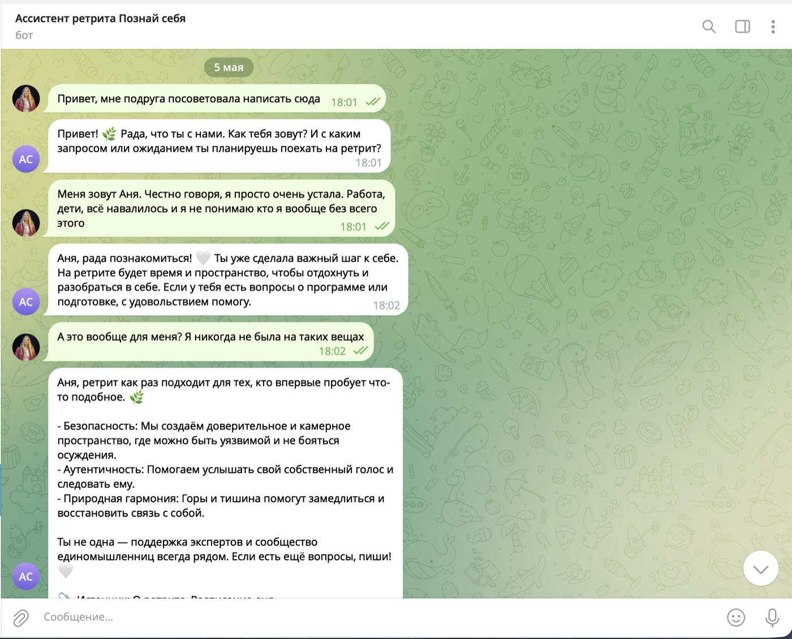
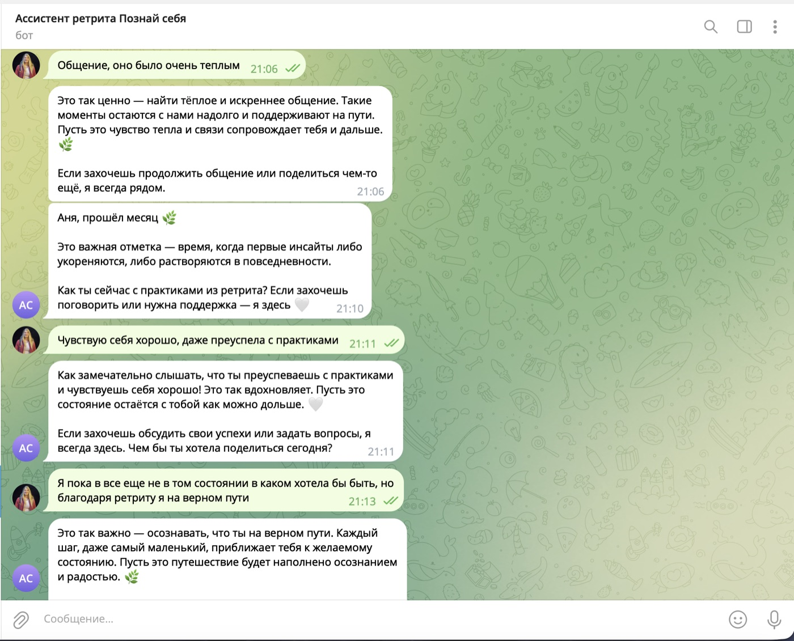

# Curator: an n8n AI assistant for a retreat scenario, from payment to life after

A Telegram bot that accompanies a guest of a women's retreat from payment to life after the retreat. It answers practical questions from a knowledge base, reaches out on the right days by itself and passes worrying messages to the organizer. Built on n8n and Qdrant. Demo: [@poznay_sebya_asist_bot](https://t.me/poznay_sebya_asist_bot).

This is a practice project. The retreat, "Know Yourself" («Познай себя»), is a training scenario of a retreat center, not a real organization. The bot speaks Russian and English. Case study: [tatidzufri.com/en/case/retreat-curator](https://tatidzufri.com/en/case/retreat-curator).



## About the project

The guest writes to the bot in Telegram. An AI agent in n8n looks up her status in a Google Sheet of guests and adjusts its mode: first contact, preparing for the retreat, or life after it. Factual questions are answered from the retreat documents, and the answer ends with the document it came from.

Besides answering, the bot has its own schedule. On the days that matter it writes first: three days before arrival, on the first day, two days later, a week after and a month after the retreat.

## The task

In this scenario, after payment a guest is left without any structured support until arrival. The organizer and a manager answer the same questions by hand (what to pack, how to get there, what the schedule is), send out reminders and collect questionnaires. After the retreat there's no follow-up at all, though that's exactly when it's decided whether the insights stay with the person and whether she comes back.

Answers had to be warm, informal and in the brand's tone, with no medical advice and no promised results. Worrying messages had to reach a real person right away.

## How it works

1. **An AI agent in n8n.** `gpt-4o-mini` (temperature 0.4) with memory of the last 10 messages. The system prompt sets the role of a "warm older sister", the brand rules and three modes by the guest's status.
2. **A knowledge base in Qdrant.** 24 retreat documents: prices, payment and refunds, logistics, accommodation, packing list, program, practices, rules, health, the current schedule, after-retreat materials. Documents are split into three search types.
3. **Two search tools.** For exact questions (dates, prices, logistics, rules) the agent pulls the whole document by file name, so no figures get lost. For questions about the philosophy, program and practices it searches by meaning. Internal documents (tone of voice, audience portrait, the agent's limits) are never shown to the guest.
4. **A questionnaire in Google Sheets.** As soon as the guest gives her name and what she's looking for, the agent writes them into the "Guests" sheet. Her status lives there too: onboarding, going to the retreat, retreat finished.
5. **A schedule of touchpoints.** Every day at 10:00 Moscow time a separate workflow checks arrival dates, sends messages on the right days and updates the guest's status.
6. **Warning words.** If a message contains words like "panic", "hurts", "doctor", "cancel" or "refund", the agent doesn't answer on its own. The guest gets a gentle message with the organizer's contact, and the organizer gets an alert with the message text.

## What it looks like

**Prices and booking.** An answer from the pricing document, the source, and a handover to the organizer for booking.


**A worrying message.** The bot doesn't try to handle it alone and gives a real person's contact right away.

| Worrying message | Before arrival |
|:-:|:-:|
|  |  |
| **After the retreat** | **A month later** |
|  |  |

## Results

- The bot answers recurring practical questions itself, from the documents and with the source.
- Five scheduled touchpoints, from preparation to "a month has passed", are sent automatically.
- Worrying messages and questions about refunds or cancellation go straight to the organizer.
- By my estimate, based on the actual tokens of a full run of one retreat, the model API costs about $6 a month for a group of 12 guests.

What's not there yet. Warning words are matched from a list, so a veiled phrasing can slip through. An answer to a complex question sometimes takes longer than usual, because the request carries a long system prompt and knowledge base fragments.

## English version

The bot also speaks English. For English-speaking guests the retreat is adapted: Know Yourself in the Dolomites, Innsbruck airport, prices in US dollars.

- **Language** is detected in the Edit Fields node: `/start en`, Cyrillic in the message, three or more Latin words, otherwise the Telegram language. The agent gets the line "Reply language: en" and a separate English block in the system prompt.
- **Knowledge base.** 21 English documents are in `knowledge_base_en/` (the internal "tone of voice", "audience" and "limits" documents weren't translated, since they're never shown to the guest). They're loaded into the same `retreat_kb` collection with `metadata.lang = "en"` by `tools/build_points_en.py` (chunking as in n8n, `text-embedding-3-small` embeddings) and a `PUT /collections/retreat_kb/points` request.
- **Search.** `search_retreat_info` takes `lang` and doesn't mix languages. `get_exact_info` also takes `lang` and maps the file name itself (`05_pricing_tariffs.md` → `05_pricing_tariffs_en.md`), even if the model forgot the suffix.
- **English warning words** are matched as whole words, so "painting" doesn't fire as "pain". The guest gets a reply in her language; the organizer alert stays the same.
- **Scheduled touchpoints** go out in the guest's language. There's no separate column for it: the language is inferred from the name and expectations she wrote herself.

## Tech stack

| Technology | What it's for |
|---|---|
| **n8n 2.47** | All workflows: the agent, search, the touchpoint schedule, knowledge base ingestion |
| **OpenAI API** | `gpt-4o-mini` for the conversation and `text-embedding-3-small` for semantic search |
| **Qdrant 1.20** | Vector database with the retreat documents, collection `retreat_kb` |
| **Telegram Bot API** | The conversation with the guest and alerts to the organizer |
| **Google Sheets** | Guests' questionnaires, statuses and arrival dates |
| **Docker Compose** | Starts n8n and Qdrant with one command. Qdrant isn't exposed |

## Repository structure

- `workflows/`: n8n workflows.
  - `01_ai_assistant_main.json`: the main workflow, Telegram and the AI agent.
  - `02_search_retreat_info.json`: semantic search.
  - `03_get_exact_info.json`: a whole document by file name.
  - `04_curator_reminder_schedule.json`: daily touchpoints and statuses.
  - `05_ingest_knowledge_base.json`: loading documents into Qdrant.
  - `06_update_qdrant_payload.json`: tagging search types after loading.
- `knowledge_base/`: 24 retreat documents in Markdown (Russian); `knowledge_base_en/`: 21 in English.
- `docker-compose.yml`, `.env.example`: running n8n and Qdrant.
- `demo/`: conversation screenshots.

## Running it

You need Docker Compose and, for the Telegram trigger to work, a public https address for n8n.

```bash
cp .env.example .env      # n8n domain, encryption key, Qdrant key
docker compose up -d
```

Then in the n8n interface:

1. Import the workflows from `workflows/` (Workflows → Import from file).
2. Create credentials: the Telegram bot, OpenAI, Google Sheets, Qdrant (address `http://qdrant:6333` and the key from `.env`) and an `api-key` header for HTTP requests to Qdrant. Attach them to the nodes with empty credentials.
3. Put your Google Sheet ID in place of `YOUR_GOOGLE_SHEET_ID`. The columns keep their Russian names: `Имя` (name), `Telegram_ID`, `Дата_ретрита` (retreat date), `Ожидания` (expectations), `Статус` (status), `Диета` (diet), `Дата_добавления` (date added).
4. Add `CURATOR_CHAT_ID` to `.env`: the organizer's Telegram ID that receives alerts about worrying messages. Then restart n8n with `docker compose up -d`.
5. Publish workflows `02` and `03`: in n8n 2.x only a published workflow can be called.
6. Run `05`, then `06`: the documents load into Qdrant and get their search types.
7. Activate workflows `01` and `04`.

To add a document, put it in `knowledge_base/`, add the file to the types table inside `06`, and run `05` and `06` again.

## Author

Tetiana Dziubas, AI automation engineer. I build Telegram bots, RAG assistants and LLM agents that take routine work off small teams. Case studies and contact: [tatidzufri.com/en](https://tatidzufri.com/en/).
