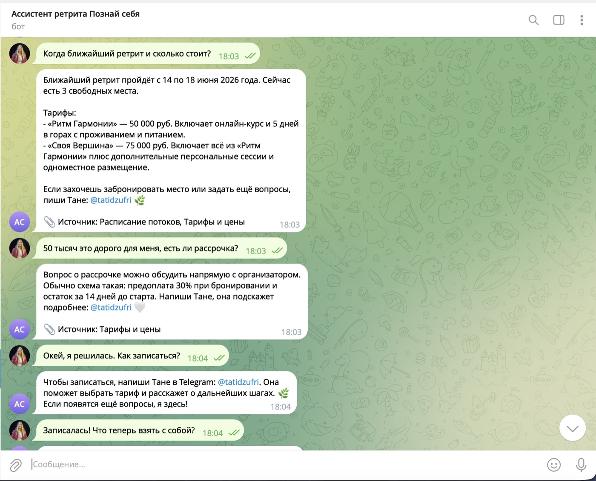
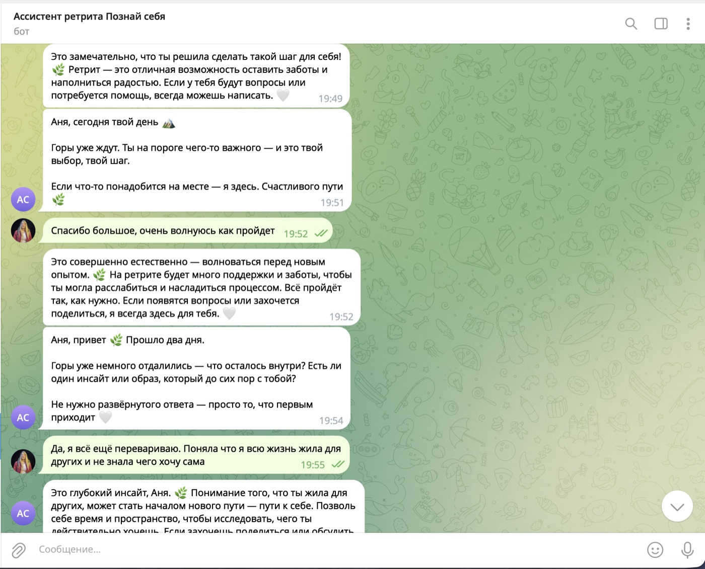
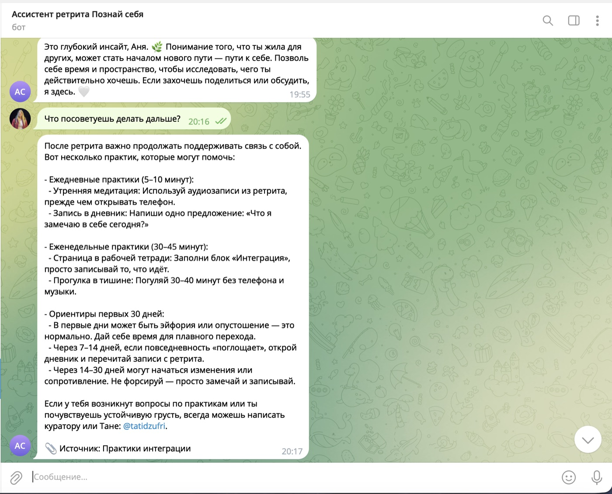
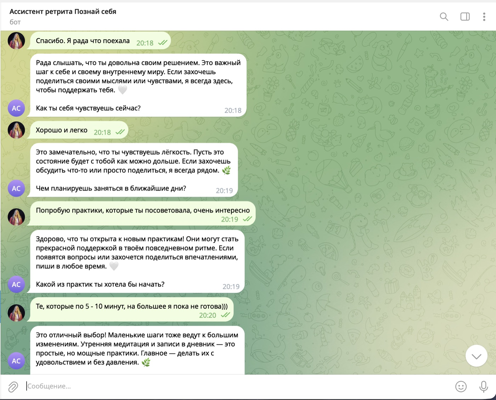

# «Куратор»: AI-ассистент участницы ретрита «Познай себя»

Telegram-бот сопровождает участницу женского ретрита от оплаты до жизни после него: отвечает на организационные вопросы по базе знаний, сам напоминает о себе в нужные дни и передает организатору тревожные сообщения. Собран на n8n и Qdrant. Демо: [@poznay_sebya_asist_bot](https://t.me/poznay_sebya_asist_bot).


## О проекте

Участница пишет боту в Telegram. AI-агент в n8n узнает ее статус из Google-таблицы участниц и подстраивает режим: первый контакт, подготовка к ретриту или жизнь после него. На фактические вопросы он отвечает по документам ретрита и в конце пишет, из какого документа взят ответ.

Кроме ответов, у бота есть собственное расписание. В важные для нее дни он сам пишет участнице: за три дня до заезда, в день начала, через два дня, через неделю и через месяц после ретрита.

## Задача

После оплаты участницы оставались без системного сопровождения до самого заезда. Организатор и менеджер вручную отвечали на одни и те же вопросы (что взять, как добраться, какое расписание), рассылали памятки и собирали анкеты. На каждый заезд это занимало 5–8 часов. Работы после ретрита не было вовсе, хотя именно тогда решается, останутся ли инсайты с человеком и вернется ли он снова.

Отвечать нужно было тепло, на «ты», в тоне бренда, без медицинских советов и обещаний результата. Тревожные сообщения должны сразу попадать к живому человеку.

## Решение

1. **AI-агент на n8n.** Модель `gpt-4o-mini` (температура 0,4) с памятью на последние 10 сообщений. Системный промпт задает роль «теплой старшей сестры», правила бренда и три режима по статусу участницы.
2. **База знаний в Qdrant.** 24 документа ретрита: цены, оплата и возврат, логистика, проживание, список вещей, программа, практики, правила, здоровье, текущее расписание, материалы после ретрита. Документы разделены на три типа поиска.
3. **Два инструмента поиска.** Для точных вопросов (даты, цены, логистика, правила) агент берет документ целиком по имени файла, чтобы не потерять цифры. Для вопросов о философии, программе и практиках он ищет по смыслу. Служебные документы (тон голоса, портрет аудитории, ограничения агента) участнице не выдаются.
4. **Анкета в Google Таблице.** Как только участница назвала имя и свой запрос, агент сам записывает их в таблицу «Участницы». Там же хранится статус: онбординг, едет на ретрит, ретрит завершен.
5. **Расписание касаний.** Каждый день в 10:00 по Москве отдельный сценарий проверяет даты заездов и шлет сообщения в нужные дни, а заодно обновляет статус участницы.
6. **Тревожные слова.** Если в сообщении есть «паника», «болит», «врач», «отмена», «возврат» и другие слова из списка, агент не отвечает сам. Участница получает мягкое сообщение с контактом организатора, а организатор уведомление с текстом сообщения.

## Как это выглядит

**Цены и запись.** Ответ по документу с тарифами, ссылка на источник и передача к организатору для записи.



**Тревога.** Бот не пытается справиться сам и сразу дает контакт живого человека.

| Тревожное сообщение | Перед заездом |
|:-:|:-:|
|  |  |
| **После ретрита** | **Через месяц** |
|  |  |

## Результат

- Повторяющиеся организационные вопросы бот закрывает сам, по документам и со ссылкой на источник.
- Сопровождение после ретрита появилось и идет без участия команды: пять касаний от подготовки до отметки «прошел месяц».
- Тревожные сообщения и вопросы о возврате или отмене сразу уходят организатору.
- API модели обходится примерно в $6 в месяц на поток из 12 участниц. Расчет сделан по фактическим токенам полного прогона одного ретрита.

Что пока не так. Тревожные слова ищутся по списку, поэтому завуалированную формулировку бот может пропустить. Ответ на сложный вопрос иногда идет дольше обычного: в запрос попадает длинный системный промпт и фрагменты базы знаний.

## Английская версия

Бот говорит и по-английски, для англоязычных участниц ретрит адаптирован: Know Yourself в Доломитах, аэропорт Инсбрук, цены в долларах.

- **Язык** определяется в узле Edit Fields: `/start en`, кириллица в сообщении, три и больше латинских слова, иначе язык Telegram. Агент получает строку «Язык ответа: en» и отдельный английский блок в системном промпте.
- **База знаний.** 21 документ на английском лежит в `knowledge_base_en/` (служебные «тон голоса», «аудитория» и «ограничения» не переводились: участнице они не выдаются). Они загружены в ту же коллекцию `retreat_kb` с `metadata.lang = "en"` скриптом `tools/build_points_en.py` (разбиение как в n8n, эмбеддинги `text-embedding-3-small`) и запросом `PUT /collections/retreat_kb/points`.
- **Поиск.** `search_retreat_info` принимает `lang` и не смешивает языки. `get_exact_info` тоже принимает `lang` и сам приводит имя файла к нужному (`05_pricing_tariffs.md` → `05_pricing_tariffs_en.md`), даже если модель забыла суффикс.
- **Тревожные слова** на английском ищутся целыми словами, чтобы «painting» не сработал как «pain». Ответ участнице на ее языке, уведомление организатору прежнее.
- **Касания по расписанию** уходят на языке участницы. Отдельной колонки в таблице нет: язык определяется по имени и ожиданиям, которые она написала сама.

## Стек технологий

| Технология | Зачем используется |
|---|---|
| **n8n 2.47** | Все сценарии: агент, поиск, расписание касаний, загрузка базы знаний |
| **OpenAI API** | `gpt-4o-mini` для диалога и `text-embedding-3-small` для поиска по смыслу |
| **Qdrant 1.20** | Векторная база с документами ретрита, коллекция `retreat_kb` |
| **Telegram Bot API** | Диалог с участницей и уведомления организатору |
| **Google Sheets** | Анкеты, статусы и даты заездов участниц |
| **Docker Compose** | n8n и Qdrant поднимаются одной командой. Qdrant наружу не открыт |

## Структура репозитория

- `workflows/`: сценарии n8n.
  - `01_ai_assistant_main.json`: главный сценарий, Telegram и AI-агент.
  - `02_search_retreat_info.json`: поиск по смыслу.
  - `03_get_exact_info.json`: документ целиком по имени файла.
  - `04_curator_reminder_schedule.json`: ежедневные касания и статусы.
  - `05_ingest_knowledge_base.json`: загрузка документов в Qdrant.
  - `06_update_qdrant_payload.json`: разметка типов поиска после загрузки.
- `knowledge_base/`: 24 документа ретрита в Markdown.
- `docker-compose.yml`, `.env.example`: запуск n8n и Qdrant.
- `demo/`: скриншоты диалогов.

## Запуск

Нужны Docker Compose и для работы Telegram-триггера публичный https-адрес n8n.

```bash
cp .env.example .env      # домен n8n, ключ шифрования, ключ Qdrant
docker compose up -d
```

Дальше в интерфейсе n8n:

1. Импортируйте сценарии из `workflows/` (Workflows → Import from file).
2. Создайте учетные данные: Telegram-бот, OpenAI, Google Sheets, Qdrant (адрес `http://qdrant:6333` и ключ из `.env`) и заголовок `api-key` для HTTP-запросов к Qdrant. Подключите их к узлам, где учетные данные пустые.
3. Укажите ID своей Google-таблицы вместо `YOUR_GOOGLE_SHEET_ID`. Колонки: `Имя`, `Telegram_ID`, `Дата_ретрита`, `Ожидания`, `Статус`, `Диета`, `Дата_добавления`.
4. Впишите в `.env` переменную `CURATOR_CHAT_ID`: Telegram ID организатора, на него придут уведомления о тревожных сообщениях. Затем перезапустите n8n командой `docker compose up -d`.
5. Опубликуйте сценарии `02` и `03`: в n8n 2.x вызывать можно только опубликованный сценарий.
6. Запустите `05`, затем `06`: документы загрузятся в Qdrant и получат типы поиска.
7. Включите сценарии `01` и `04`.

Чтобы добавить документ, положите его в `knowledge_base/`, допишите файл в таблицу типов внутри `06` и снова запустите `05` и `06`.

## Автор

Татьяна Дзюбас, AI-инженер по автоматизации. Делаю Telegram-ботов, RAG-ассистентов и LLM-агентов, которые снимают рутину с небольших команд. Кейсы и контакты на [tatidzufri.com](https://tatidzufri.com).
